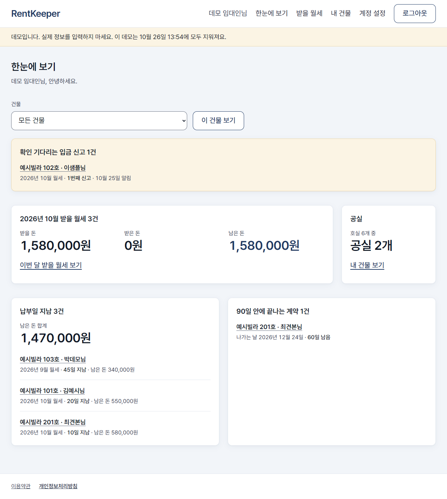
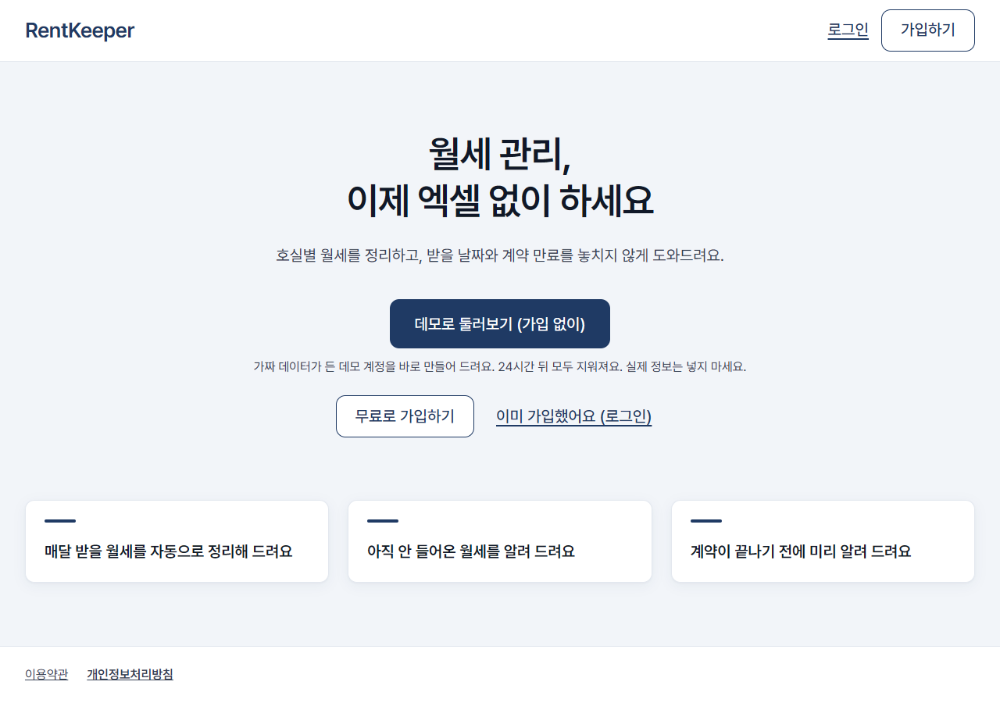
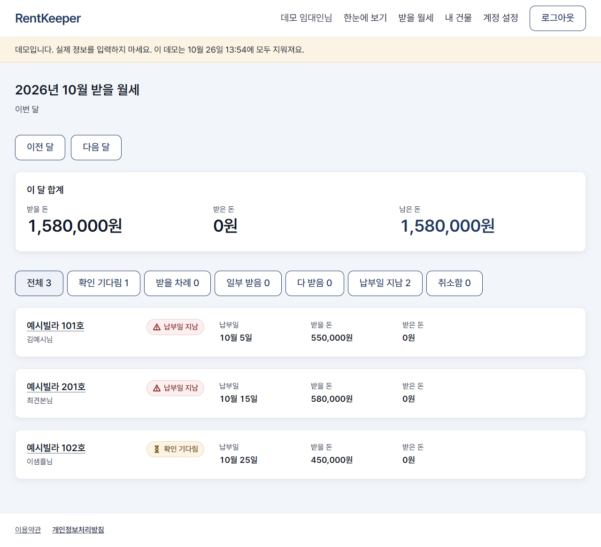
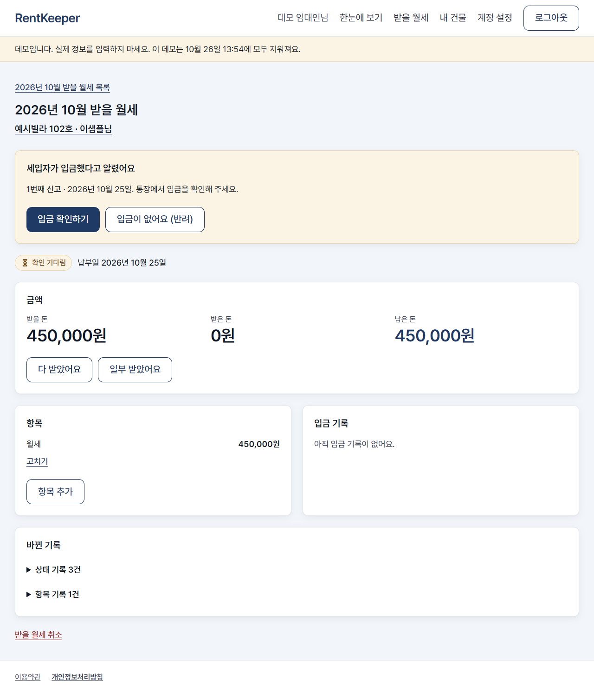
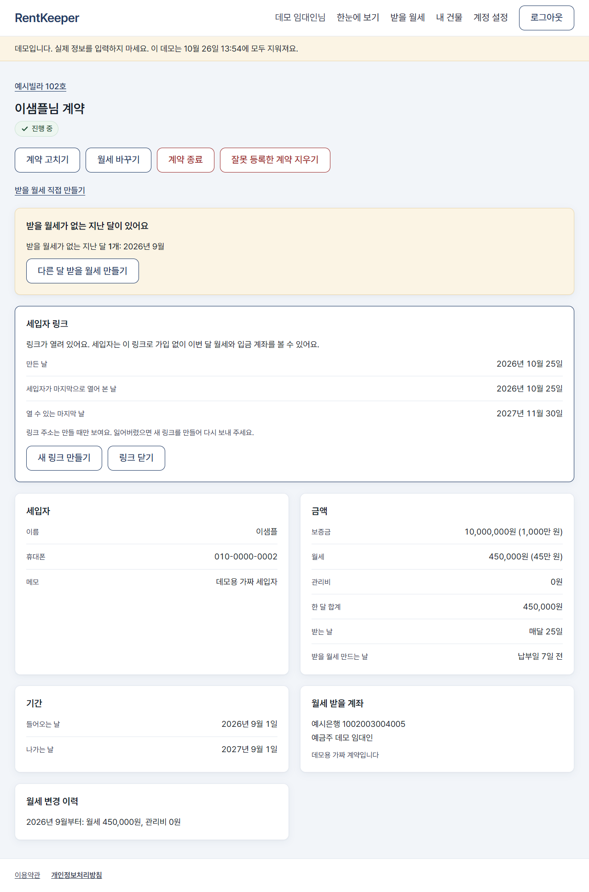
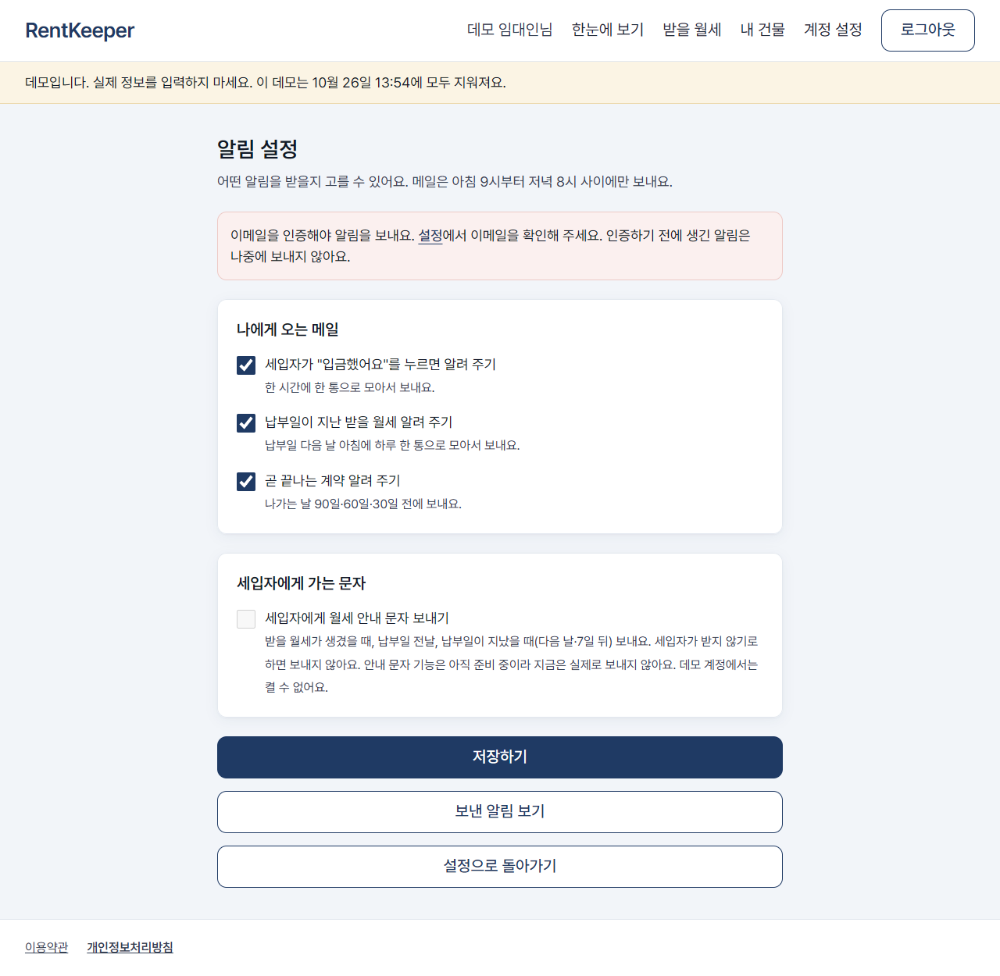
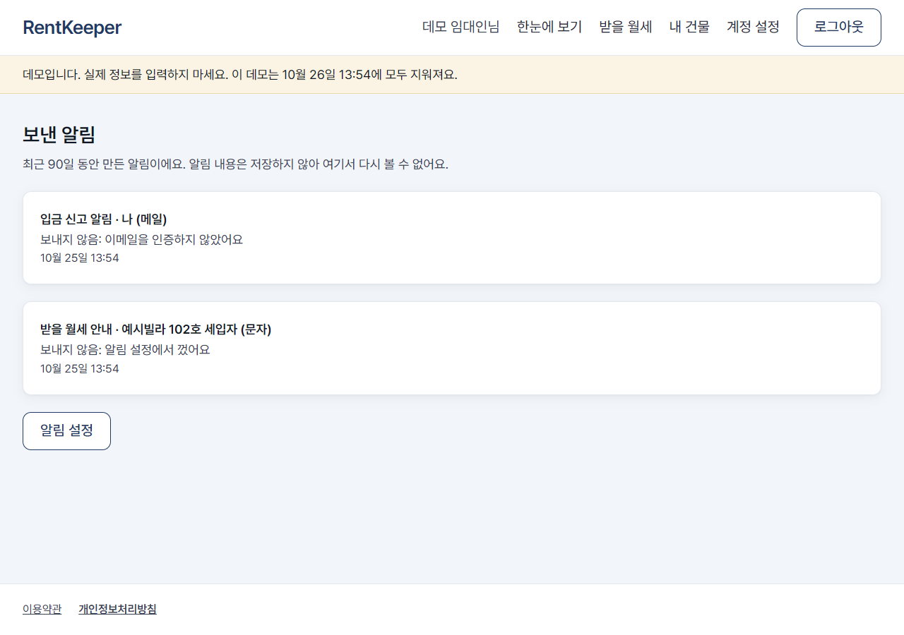
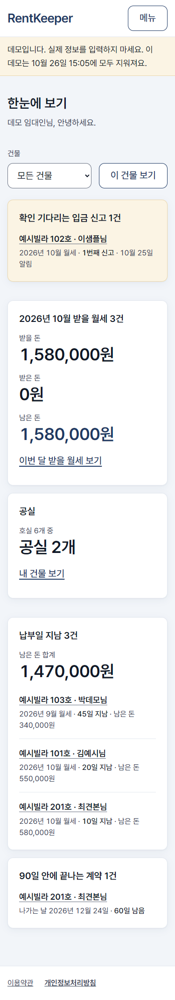
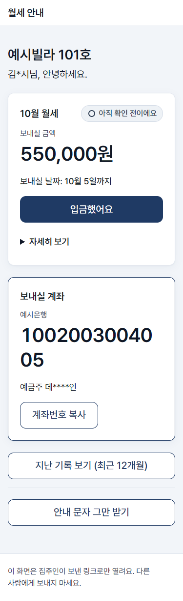
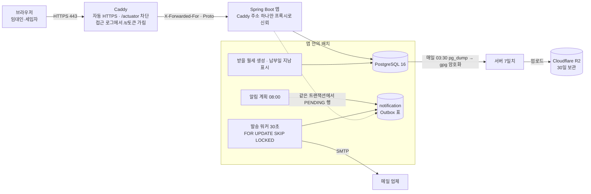

<!-- 서비스명은 messages.properties의 app.name과 같게 쓴다. 이름은 아직 바뀔 수 있다(docs/progress.md "서비스명"). 바꾸면 이 파일도 함께 고친다 -->
# RentKeeper

다가구·원룸·상가를 가진 소규모 임대인이 매달 받을 월세, 입금 확인, 계약 끝나는 날을 엑셀과 카톡 없이 관리하는 웹 서비스입니다.

AI를 전적으로 활용하여 약 1주(2026-10-17~10-25) 동안 만든 개인 프로젝트입니다. 실서버에는 배포하지 않았고, 운영 구성을 로컬 Docker에서 그대로 띄워 확인했습니다([배포](#배포)).



## 목차
- [만든 방식](#만든-방식)
- [주요 기능](#주요-기능)
- [기술 스택](#기술-스택)
- [아키텍처](#아키텍처)
- [보안 설계](#보안-설계)
- [테스트](#테스트)
- [로컬에서 실행](#로컬에서-실행)
- [배포](#배포)
- [더 읽을 거리](#더-읽을-거리)

## 만든 방식

### 역할 분담
| 누가 | 한 일 |
|---|---|
| Claude (채팅) | 기획서(`docs/PRD.md`) 정리, 마일스톤 설계 검토 |
| Claude Code | 구현, 테스트, 마이그레이션 초안, ADR·진행 기록 초안, 브라우저 자동 확인 |
| 나 | 마일스톤마다 계획 승인, 설계 결정, 마이그레이션 SQL 확인, 화면 확인, 병합 |

### AI를 통제한 작업 규칙
AI가 지켜야 할 규칙을 저장소의 [`CLAUDE.md`](CLAUDE.md)와 [`docs/progress.md`](docs/progress.md)에 적고, 마일스톤마다 지시로 더했습니다.
- **계획 먼저**: 구현 전에 계획을 내고 승인받은 뒤 진행합니다. 한 번에 한 마일스톤만 합니다.
- **커밋 규칙**: `타입: 한글 요약` 형식으로 씁니다. 커밋마다 `gradlew build`(포맷 검사 + 전체 테스트)를 통과하고 `docs/progress.md`의 진행 줄을 갱신합니다. push는 내가 지시할 때만 합니다.
- **마이그레이션 확인**: 스키마는 Flyway로만 바꾸고, 기존 마이그레이션 파일은 고치지 않습니다.
  - 새 마이그레이션은 커밋 전에 SQL 전문을 내가 확인했습니다(V13~V18 등).
  - 뒤의 묶음은 [`docs/m5-migration-review.md`](docs/m5-migration-review.md) 같은 검토 문서로 확인했습니다.
- **비밀값 금지**: 비밀값은 커밋하지 않고 `.env.example`만 둡니다. 화면·로그에 키를 출력하지 않습니다.
- **멈춤 조건**: 계획과 다르게 해야 할 때, 빌드가 두 번 실패할 때, 보안 규칙을 바꿔야 할 때는 멈추고 보고합니다.
- **테스트를 약하게 만들지 않기**: 문구·동작을 확인하는 테스트는 바꾸지 않습니다. 구조 변경으로 테스트를 고칠 때는 같은 의도와 강도로 맞추고, 이유를 커밋과 문서에 남깁니다.
- **결정 기록**: 설계 결정은 ADR(`docs/decisions/`)로 남겨, 세션이 끊겨도 다시 설명하지 않게 했습니다.

### 판단 내용
1. **디자인 방향을 다시 잡음** ([ADR-032](docs/decisions/ADR-032-design-system.md))
   - 처음 화면은 가독성(큰 글씨·두꺼운 선)만 보고 만들어 "저렴해 보인다"고 판단했습니다.
   - 대시보드 한 화면으로 A안·B안을 비교하게 한 뒤, B안 바탕에 A안의 남색만 섞은 안을 골랐습니다. 화면을 직접 보고 확정했습니다.
2. **의심 동작은 고치기 전에 테스트로 먼저 확인** ([progress "디자인 교체 뒤 동작 확인 2건"](docs/progress.md))
   - 디자인 교체 뒤 "남의 ID가 다른 응답을 주는가", "마지막 항목 지우기가 정말 막히는가"를 코드 수정 없이 조사·테스트만 먼저 하게 했습니다.
   - 결과를 보고 고칠 것만 별도 브랜치에서 고쳤습니다.
3. **배포 전 로컬 리허설** ([progress "로컬 배포 리허설"](docs/progress.md))
   - 운영 구성을 내 PC Docker에서 그대로 띄우게 했습니다.
   - 그 과정에서 `MAIL_PORT`를 비우면 587이 아니라 25번으로 붙는 버그를 찾았습니다.
4. **세입자 안내 횟수를 줄임** ([ADR-028](docs/decisions/ADR-028-notification-outbox.md))
   - 기획서의 "당일·전일, D+1·3·7"을 "전날 1회, D+1·D+7"로 줄였습니다.
   - 받는 사람이 40~60대 세입자이고, 임대인 대신 보내는 문자가 독촉처럼 느껴지면 관계를 해칠 수 있어서입니다.
5. **알림 표에 개인정보를 남기지 않는 조건** ([ADR-028](docs/decisions/ADR-028-notification-outbox.md))
   - Outbox에 전화번호·본문·링크 원문을 저장하지 않습니다.
   - 실제 발송기가 없는 환경에서는 세입자 알림을 보내지 않고, 나중에 켜도 과거 알림이 한꺼번에 나가지 않게 했습니다.
6. **[링크 닫기]의 뜻을 지킴** ([ADR-029](docs/decisions/ADR-029-notification-tenant-link.md))
   - 임대인이 링크를 닫아도 다음 알림이 새 링크를 만들면 닫은 의미가 없습니다.
   - 그래서 닫으면 그 계약의 알림 링크 발급도 멈추고, [알림 다시 켜기]로만 다시 시작하게 바꿨습니다.
7. **공개 데모 보강** ([ADR-031](docs/decisions/ADR-031-public-access-demo.md)): 방문자용 데모에 다음을 더하게 했습니다.
   - 동시 계정 상한(advisory lock)
   - IP당 시작 횟수 제한
   - 데모 계정의 비밀번호·이메일 변경과 탈퇴 금지

## 주요 기능
캡처는 모두 [데모로 둘러보기]의 가짜 데이터입니다.

| 첫 화면 | 받을 월세 목록 |
|---|---|
|  |  |

- **건물·호실·계약 관리**: 호실마다 세입자, 계약 기간, 월세·관리비, 납부일을 등록합니다. 월세가 바뀐 이력도 남습니다.
- **매달 받을 월세 자동 생성**: 배치가 계약마다 이번 달 받을 월세를 만듭니다. 배치가 며칠 멈춰도 빠진 달을 되살려 만들고, 같은 달은 두 번 만들지 않습니다.
- **입금 기록과 정정**: 나눠 받은 입금, 초과 입금 확인, 기록 정정·삭제(사유와 함께 이력으로 남김), 항목 수정과 취소를 지원합니다.

| 받을 월세 상세 (세입자가 입금했다고 알린 상태) | 계약 상세 |
|---|---|
|  |  |

- **세입자 링크**: 세입자는 가입 없이 임대인이 보낸 링크로 자기 계약의 받을 월세와 입금 계좌를 보고 [입금했어요]로 알립니다. 임대인은 확인하거나 사유를 적어 반려합니다.
- **대시보드**: 한 화면에 다음을 보여 줍니다.
  - 확인 기다리는 입금 신고
  - 이번 달 받을 돈·받은 돈·남은 돈
  - 납부일이 지난 것
  - 90일 안에 끝나는 계약
  - 공실
- **알림**
  - 임대인에게는 입금 신고 접수, 납부일 지남 요약, 곧 끝나는 계약 메일을 보냅니다(발송 시간 09:00~20:00).
  - 세입자 안내 문자 채널은 만들어 두었지만, 문자 대행사를 붙이기 전까지 꺼져 있습니다.
  - 세입자는 링크 화면에서 안내 문자를 끌 수 있습니다.

| 알림 설정 | 보낸 알림 |
|---|---|
|  |  |

- **로그인**: 이메일(인증 메일, 비밀번호 재설정, 로그인 유지)과 카카오 로그인을 지원합니다. 가입은 초대 코드가 있어야 하고, 방문자는 24시간짜리 데모 계정으로 둘러볼 수 있습니다.
- **반응형**: 휴대폰·태블릿·PC 모두 같은 화면을 씁니다(768px 대시보드: [캡처](docs/screenshots/dashboard-768.png)).

| 휴대폰 대시보드 (375px) | 세입자 화면 |
|---|---|
|  |  |

## 기술 스택
| 영역 | 사용 |
|---|---|
| 언어·프레임워크 | Java 21, Spring Boot 4.1, Spring Security 7, Spring Session JDBC |
| 화면 | Thymeleaf 서버 렌더링, Tailwind CSS v4(Standalone CLI, Node 없음), 직접 넣은 Pretendard 글꼴 |
| 데이터 | PostgreSQL 16, Spring Data JPA, Flyway (마이그레이션 V1~V22) |
| 배치 | `@Scheduled` + ShedLock(JDBC) |
| 테스트 | JUnit 5, Testcontainers(PostgreSQL), MockMvc, 실제 내장 Tomcat 테스트, ArchUnit |
| 운영 구성 | Docker 이미지(GitHub Actions → GHCR), Docker Compose(Caddy · 앱 · PostgreSQL), Caddy 자동 HTTPS |
| 품질 | Spotless(Eclipse 포매터), GitHub Actions CI(`gradlew build`), Dependabot |

QueryDSL과 HTMX는 처음 계획에 있었지만 필요하지 않아 넣지 않았습니다([ADR-021](docs/decisions/ADR-021-querydsl-deferred.md), M5 결정).

## 아키텍처



- **모듈러 모놀리스**: 아래 패키지로 나누고, 의존 방향을 ArchUnit 테스트로 강제합니다.
  - 기능: `landlord`·`auth`·`consent`·`property`·`lease`·`billing`·`tenantlink`·`notification`·`dashboard`·`demo`·`site`
  - 공용 `common`, 조립용 `config`
- **알림은 Outbox**로 보냅니다. 업무와 같은 트랜잭션에서 행만 넣고, 워커가 발송 시간에 맞춰 보냅니다.
- 위 그림의 Caddy·백업·R2는 운영 구성 파일로 준비했고 로컬 리허설에서 확인했습니다. 실서버와 R2 버킷은 만들지 않았습니다.

## 보안 설계
자세한 판단 과정(문제 → 고른 방법 → 버린 대안 → 확인 방법)은 [`docs/portfolio-notes.md`](docs/portfolio-notes.md)에 있습니다.

| 주제 | 방법 | 근거 |
|---|---|---|
| 다른 임대인의 데이터(IDOR) | 리포지토리에 `findById`가 없고 모든 조회가 `landlordId`를 받습니다. 없는 ID와 남의 ID는 같은 404입니다. DB도 `(부모_id, landlord_id)` 복합 FK로 다른 임대인의 행을 가리킬 수 없게 막습니다 | [ADR-018](docs/decisions/ADR-018-owned-data-isolation.md) |
| 세입자 링크 토큰 | 256비트 무작위 토큰을 만들고 DB에는 SHA-256만 저장합니다. 원문은 만든 직후 한 번만 보여 주고, 만료일은 계약 끝 + 90일로 계산합니다 | [ADR-026](docs/decisions/ADR-026-tenant-access-link.md) |
| `/t/**` 무세션 체인 | 세입자 화면은 별도 보안 체인입니다. 세션·로그인 유지·CSRF 토큰 없이 같은 출처 POST만 받고, `Referrer-Policy: same-origin`·`noindex`·`no-store`를 붙입니다 | [ADR-026](docs/decisions/ADR-026-tenant-access-link.md) |
| 개인정보 암호화 | 세입자 이름·연락처·메모, 계좌번호·예금주를 AES-256-GCM으로 저장합니다. 컬럼마다 용도 문자열을 AAD로 묶어, 다른 칸으로 옮긴 암호문은 풀리지 않습니다. 전화번호 중복 확인은 HMAC-SHA256으로 합니다 | [ADR-017](docs/decisions/ADR-017-field-encryption.md) |
| 프록시 뒤 클라이언트 IP | 앱은 compose가 Caddy에 준 고정 주소 하나만 프록시로 믿습니다. 그래서 IP별 레이트 리미트가 Caddy 주소 하나로 묶이지 않고, 다른 곳에서 꾸민 X-Forwarded-For는 무시합니다 | [ADR-030](docs/decisions/ADR-030-deployment-topology.md) |
| 로그 가리기 | Caddy 접근 로그와 오류 로그 모두에서 `/t/{토큰}`(주소·Referer)을 `/t/***`로 바꾸고 쿠키·인증 헤더를 지웁니다 | [ADR-030](docs/decisions/ADR-030-deployment-topology.md) |
| 기타 | 인라인 스크립트·스타일 없는 CSP, BCrypt, 로그인 잠금과 IP별 제한, remember-me 토큰 회전. 없는 주소는 기본 거부를 지키면서 404로 보냅니다 | [ADR-008](docs/decisions/ADR-008-security-headers-csp-access.md), [ADR-009](docs/decisions/ADR-009-password-policy-and-hashing.md), [ADR-012](docs/decisions/ADR-012-login-lock-and-rate-limit.md), [ADR-013](docs/decisions/ADR-013-remember-me-persistent-token.md) |

## 테스트
`.\gradlew.bat build`가 포맷 검사와 전체 테스트를 돌립니다(Docker 필요). 테스트는 **653개**입니다(테스트 클래스 108개, 2026-10-25 `gradlew build` 테스트 보고서 기준, 실패·건너뜀 0).

- **실제 PostgreSQL로 테스트**: Testcontainers로 운영과 같은 `postgres:16-alpine`을 띄우고, 모든 마이그레이션을 적용한 DB에서 돌립니다. 동시성·잠금·UNIQUE 제약·`ON CONFLICT`를 실제 DB 동작으로 확인합니다.
- **IDOR 전수 테스트(`IdorTests`)**: 다른 임대인의 ID로 임대인 엔드포인트 51개를 모두 호출합니다.
  - 모두 404이고, 상태·본문·헤더가 없는 ID의 404와 같은지 봅니다.
  - 소유 테이블이 한 글자도 바뀌지 않는지 봅니다.
  - 실제 매핑과 공격 표가 어긋나면(새 엔드포인트를 표에 넣지 않으면) 빌드가 실패합니다.
- **세입자 링크 공격 표**: 세입자 엔드포인트 8개에 닫힌 링크·임의 토큰·형식이 틀린 토큰·기간이 지난 링크·다른 계약의 청구를 넣습니다. 모두 같은 404이고 데이터가 바뀌지 않는지 봅니다.
- **ArchUnit**: 다음을 어기면 빌드가 실패합니다.
  - 모듈 의존 방향
  - 다른 모듈의 엔티티·리포지토리 사용
  - 인자 없는 `LocalDate.now()` 같은 시간 호출
  - ShedLock 없는 `@Scheduled`
- **저장소 규칙 테스트**: 소유 데이터 리포지토리에 `findById`가 없고 모든 조회가 `landlordId`를 받는지 검사합니다.
- **실제 내장 Tomcat 테스트**: MockMvc로는 볼 수 없는 것을 실제 HTTP로 확인합니다. 오류 화면 글자, 프록시 헤더 신뢰 범위, 없는 주소의 404 처리, robots.txt, 렌더된 HTML에 내부 주석이 없는지 등입니다.
- **배포 파일 테스트(`DeploymentFilesTest`)**: 다음을 봅니다.
  - compose의 Caddy 주소와 앱이 믿는 프록시 주소가 같은지
  - 앱·DB가 포트를 열지 않는지
  - Caddy가 `/actuator`를 막고 토큰을 가리는지
  - `.env.prod.example`이 설정이 읽는 환경변수를 모두 담는지
- **스키마 설명 테스트**: 설명(COMMENT)이 빠진 테이블·컬럼이 있으면 빌드가 실패합니다.

## 로컬에서 실행
필요한 것: JDK 21, Docker Desktop.

```powershell
Copy-Item .env.example .env        # 값을 채운다(암호화 키 만드는 방법은 .env.example 주석)
docker compose --env-file .env -f docker\docker-compose.yml up -d   # 로컬 PostgreSQL
.\gradlew.bat bootRun              # http://localhost:8080 → [데모로 둘러보기]
.\gradlew.bat tailwindWatch        # (다른 터미널) 화면을 고칠 때 CSS 자동 재빌드
```

- 기본 프로필은 `local`입니다. 메일은 보내지 않고 로그로 남기며, 카카오 값이 없으면 카카오 로그인을 끕니다. 데모는 켜져 있습니다.
- 운영 구성(Caddy·HTTPS 포함)을 내 PC에서 그대로 띄워 보려면 [`docs/runbook.md`](docs/runbook.md) 13번 "로컬 배포 리허설"을 따릅니다.

## 배포
**실서버에는 배포하지 않았습니다.** 운영에 필요한 파일은 모두 만들었고, 같은 구성을 로컬 Docker에서 운영 프로필로 띄워 확인했습니다. `docs/deploy-checklist.md`, `docs/runbook.md`는 실제 배포를 전제로 쓴 문서입니다.

### 준비한 운영 구성
- **이미지**: [`Dockerfile`](Dockerfile)은 빌드 단계와 실행 단계를 나눴습니다(535MB). 버전 태그를 올리면 GitHub Actions가 GHCR에 올리도록 만들었습니다.
- **compose**: [`docker/compose.prod.yml`](docker/compose.prod.yml)에 `caddy`·`app`·`postgres`를 둡니다. 밖으로 여는 포트는 Caddy의 80·443뿐이고, Caddy는 고정 내부 주소를 씁니다.
- **Caddy**: [`docker/Caddyfile`](docker/Caddyfile)이 자동 HTTPS, `/actuator` 차단, 로그 가리기를 맡습니다.
- **백업**: [`scripts/backup.sh`](scripts/backup.sh)가 `pg_dump` → gpg 암호화 → 서버 7일치 + S3 호환 저장소(R2)를 맡습니다.

### 로컬 리허설에서 확인한 것 (2026-10-25)
[`docker/compose.rehearsal.yml`](docker/compose.rehearsal.yml)로 포트만 바꿔 운영 파일을 그대로 띄웠습니다.

| 항목 | 결과 |
|---|---|
| 기동 | postgres·app·caddy 모두 healthy, 운영 프로필, 빈 DB에 V1~V22 적용 |
| 보안 헤더 | CSP·HSTS·nosniff·X-Frame-Options DENY·Referrer-Policy, 로그인 쿠키 Secure·HttpOnly·SameSite=Lax |
| 세입자 링크 응답 | `same-origin`·noindex·no-store, Set-Cookie 없음 |
| 바깥에서 `/actuator` | 모두 404 |
| 클라이언트 IP | 레이트 리미트 키에 Caddy 주소가 아닌 요청 출발지가 기록됨. 밖과 내부 다른 컨테이너에서 꾸민 X-Forwarded-For는 무시됨 |
| 로그 가리기 | 링크·쿼리·Referer·앱을 멈춘 상태(502)의 오류 로그까지 토큰 0건 |
| 백업·복구 | 백업 스크립트(업로드만 건너뜀)로 만든 암호화 파일을 빈 DB에 복구. 표 24개 행 수가 같고, 같은 키로 띄운 앱의 계약 화면이 원본과 같음 |
| 메모리 (가벼운 부하 뒤) | 앱 515MiB, Postgres 62MiB, Caddy 19MiB |

**찾아서 고친 것**
- **메일 포트**: `MAIL_PORT`를 비우면 안내와 달리 587이 아니라 25번으로 붙었습니다. compose에서 빈 값을 587로 바꾸고 테스트로 고정했습니다.
- **템플릿 주석 노출**: 템플릿의 HTML 주석(내부 메모)이 화면 소스에 그대로 나갔습니다. Thymeleaf 주석으로 바꾸고 테스트로 고정했습니다.
- **runbook 복구 절차**: 실제로 해 보니 맞지 않는 곳이 있어 고쳤습니다.

로컬 Docker Desktop이라 실제 사용자 IP 보존, 인증서 발급, 실제 메일 도달은 확인하지 못했습니다.

## 더 읽을 거리
- [기술 노트: 면접에서 설명할 판단 10가지](docs/portfolio-notes.md)
- [설계 결정 기록(ADR) 목록](docs/decisions/): 모두 32개입니다.
  - 인증·세션: ADR-005·009·012·013·014
  - 데이터 격리: ADR-018 / 암호화: ADR-017
  - 청구·입금: ADR-023~025
  - 세입자 링크: ADR-026·029 / 알림: ADR-028
  - 배포: ADR-030 / 디자인: ADR-032
- [진행 기록](docs/progress.md), [기획서](docs/PRD.md)
