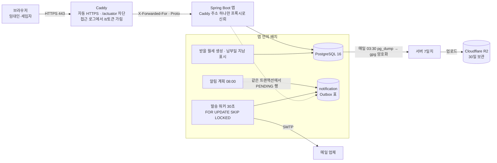

<!-- 서비스명은 messages.properties의 app.name과 같게 쓴다. 이름은 아직 바뀔 수 있다(docs/progress.md "서비스명"). 바꾸면 이 파일도 함께 고친다 -->
# RentKeeper

다가구·원룸·상가를 가진 소규모 임대인이 매달 받을 월세, 입금 확인, 계약 끝나는 날을 엑셀과 카톡 없이 관리하는 웹 서비스입니다.

(캡처 예정: 첫 화면)

## 주요 기능
- **건물·호실·계약 관리**: 호실마다 세입자와 계약 기간, 월세·관리비, 납부일을 등록합니다. 월세가 바뀐 이력도 남습니다.
- **매달 받을 월세 자동 생성**: 배치가 계약마다 이번 달 받을 월세를 만듭니다. 배치가 며칠 멈춰도 빠진 달을 되살려 만들고, 같은 달은 두 번 만들지 않습니다.
- **입금 기록과 정정**: 나눠 받은 입금, 초과 입금 확인, 기록 정정·삭제(사유와 함께 이력으로 남김), 항목 수정과 취소를 지원합니다.
- **세입자 링크**: 세입자는 가입 없이 임대인이 보낸 링크로 자기 계약의 받을 월세와 입금 계좌를 보고 [입금했어요]로 알립니다. 임대인은 확인하거나 사유를 적어 반려합니다.
- **대시보드**: 이번 달 받을 월세, 확인을 기다리는 신고, 납부일이 지난 것, 90일 안에 끝나는 계약, 공실을 한 화면에 보여 줍니다.
- **알림**: 임대인에게는 입금 신고 접수·납부일 지남 요약·곧 끝나는 계약 메일을 보냅니다. 세입자 안내 문자 채널은 만들어 두었지만 문자 대행사를 붙이기 전까지 꺼져 있습니다. 세입자는 링크 화면에서 안내 문자를 끌 수 있습니다.
- **로그인**: 이메일(인증 메일, 비밀번호 재설정, 로그인 유지)과 카카오 로그인. 가입은 초대 코드가 있어야 하고, 방문자는 24시간짜리 데모 계정으로 둘러볼 수 있습니다.

(캡처 예정: 대시보드, 받을 월세 상세, 세입자 링크 화면)

## 기술 스택
| 영역 | 사용 |
|---|---|
| 언어·프레임워크 | Java 21, Spring Boot 4.1, Spring Security 7, Spring Session JDBC |
| 화면 | Thymeleaf 서버 렌더링, Tailwind CSS v4(Standalone CLI, Node 없음), 직접 넣은 Pretendard 글꼴 |
| 데이터 | PostgreSQL 16, Spring Data JPA, Flyway (마이그레이션 V1~V22) |
| 배치 | `@Scheduled` + ShedLock(JDBC) |
| 테스트 | JUnit 5, Testcontainers(PostgreSQL), MockMvc, 실제 내장 Tomcat 테스트, ArchUnit |
| 배포 | Docker 이미지(GitHub Actions → GHCR), Docker Compose(Caddy · 앱 · PostgreSQL), Caddy 자동 HTTPS |
| 품질 | Spotless(Eclipse 포매터), GitHub Actions CI(`gradlew build`), Dependabot |

QueryDSL과 HTMX는 처음 계획에 있었지만 아직 필요하지 않아 넣지 않았습니다(ADR-021, M5 결정).

## 아키텍처



- **모듈러 모놀리스**: `landlord`·`auth`·`consent`·`property`·`lease`·`billing`·`tenantlink`·`notification`·`dashboard`·`demo`·`site`(+ 공용 `common`, 조립용 `config`) 패키지로 나누고, 의존 방향을 ArchUnit 테스트로 강제합니다.
- **세입자 링크(`/t/**`)는 별도 보안 체인**입니다. 세션·로그인 유지·CSRF 토큰을 쓰지 않고, 같은 출처의 POST만 받으며, `noindex`·`no-store`·`Referrer-Policy: same-origin`을 붙입니다.
- **알림은 Outbox**로 보냅니다. 업무와 같은 트랜잭션에서 행만 넣고, 워커가 발송 시간(09:00~20:00)에 맞춰 보냅니다. 표에는 전화번호·본문·링크 원문을 저장하지 않습니다.

## 로컬에서 실행
필요한 것: JDK 21, Docker Desktop.

```powershell
Copy-Item .env.example .env        # 값을 채운다(암호화 키 만드는 방법은 .env.example 주석)
docker compose --env-file .env -f docker\docker-compose.yml up -d   # 로컬 PostgreSQL
.\gradlew.bat bootRun              # http://localhost:8080
.\gradlew.bat tailwindWatch        # (다른 터미널) 화면을 고칠 때 CSS 자동 재빌드
```

- 기본 프로필은 `local`입니다. 메일은 보내지 않고 로그로 남기며, 카카오 값이 없으면 카카오 로그인을 끕니다.
- 운영 구성(Caddy·HTTPS 포함)을 내 PC에서 그대로 띄워 보려면 `docs/runbook.md` 13번 "로컬 배포 리허설"을 따릅니다.

## 테스트 전략
`.\gradlew.bat build`가 포맷 검사와 전체 테스트를 돌립니다(Docker 필요). 테스트는 **653개**입니다(테스트 클래스 108개, 2026-10-25 `gradlew build` 테스트 보고서 기준. 실패·건너뜀 0).

- **실제 PostgreSQL로 테스트**: Testcontainers로 운영과 같은 `postgres:16-alpine`을 띄우고, 모든 마이그레이션을 적용한 DB에서 돌립니다. 동시성·잠금·UNIQUE 제약·`ON CONFLICT`를 실제 DB 동작으로 확인합니다.
- **IDOR 전수 테스트(`IdorTests`)**: 다른 임대인의 ID로 임대인 엔드포인트 51개를 모두 호출해, 모두 404이고 본문·헤더가 없는 ID의 404와 같고, 소유 테이블이 한 글자도 바뀌지 않는지 봅니다. 실제 매핑과 공격 표가 어긋나면(새 엔드포인트를 표에 넣지 않으면) 빌드가 실패합니다.
- **세입자 링크 공격 표**: 세입자 엔드포인트 8개에 닫힌 링크·임의 토큰·형식이 틀린 토큰·기간이 지난 링크·다른 계약의 청구를 넣어 모두 같은 404이고 데이터가 바뀌지 않는지 봅니다.
- **ArchUnit**: 모듈 의존 방향, 다른 모듈의 엔티티·리포지토리 사용 금지, 인자 없는 `LocalDate.now()` 같은 시간 호출 금지, `@Scheduled`에는 ShedLock 필수.
- **저장소 규칙 테스트**: 소유 데이터 리포지토리에 `findById`가 없고 모든 조회가 `landlordId`를 받는지 검사합니다.
- **실제 내장 Tomcat 테스트**: 오류 화면 글자, 프록시 헤더 신뢰 범위(`X-Forwarded-For`), 없는 주소의 404 처리, robots.txt처럼 MockMvc로는 볼 수 없는 것을 실제 HTTP로 확인합니다.
- **배포 파일 테스트(`DeploymentFilesTest`)**: compose의 Caddy 주소와 앱이 믿는 프록시 주소가 같은지, 앱·DB가 포트를 열지 않는지, Caddy가 `/actuator`를 막고 토큰을 가리는지, `.env.prod.example`이 설정이 읽는 환경변수를 모두 담는지 봅니다.
- **스키마 설명 테스트**: 설명(COMMENT)이 빠진 테이블·컬럼이 있으면 빌드가 실패합니다.

## 배포 구성
- AWS Lightsail 서울 2GB 서버 한 대에 Docker Compose로 `caddy`·`app`·`postgres`를 띄웁니다. 밖으로 여는 포트는 Caddy의 80·443뿐입니다.
- 이미지는 버전 태그를 올릴 때 GitHub Actions가 빌드해 GHCR에 올리고, 서버에서 `pull && up -d`로 바꿉니다. 마이그레이션은 앱이 뜰 때 Flyway가 돌립니다.
- 비밀값은 서버의 `.env.prod`에만 있습니다(이름 목록은 `.env.prod.example`).
- 백업은 매일 `pg_dump` → gpg 암호화 → 서버 7일 + Cloudflare R2입니다. 복구 절차는 로컬 리허설로 확인했습니다(`docs/runbook.md` 7번).
- 자세한 절차: `docs/deploy-checklist.md`(첫 배포), `docs/runbook.md`(운영). 설계 결정: `docs/decisions/`(ADR), 기술 노트: `docs/portfolio-notes.md`.
